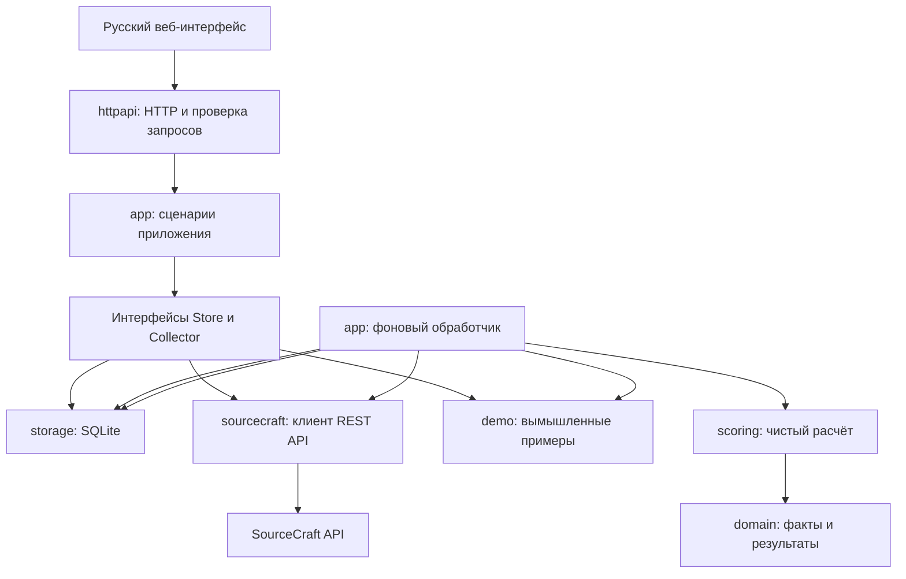
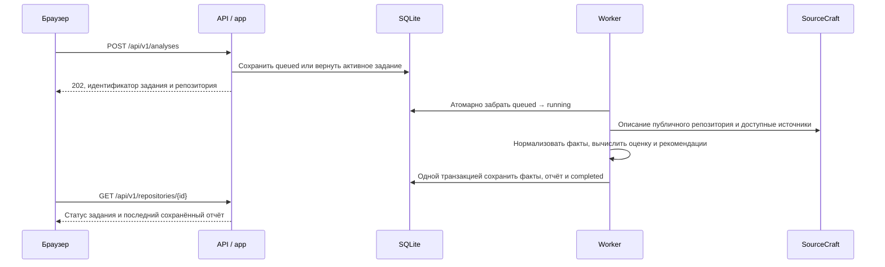

# Архитектура MVP

## Решение

Один Go-процесс обслуживает HTTP и выполняет один общий фоновый анализ за раз, а также отдельный анализ в каждой активной личной сессии. Результаты, нормализованные входные данные и очередь сохраняются в SQLite. Интерфейс на HTML/CSS/JavaScript встраивается в исполняемый файл через `go:embed`.

Такую структуру выбрали для базового MVP: локальный запуск без отдельных серверов базы и очереди, понятные границы компонентов и небольшое число зависимостей. SQLite-драйвер `modernc.org/sqlite` работает без CGo. Версии закреплены в `go.mod` и `go.sum`.

Это решение для одного экземпляра процесса с одной базой. Несколько экземпляров сервера, общая сетевая файловая система и горизонтальное масштабирование в этой версии не поддерживаются.

## Компоненты

| Путь | Обязанность |
| --- | --- |
| `cmd/repo-health` | Сборка зависимостей, конфигурация, старт HTTP и worker, корректное завершение |
| `internal/domain` | Общие сущности, идентификаторы и проверка адреса репозитория |
| `internal/sourcecraft` | Только чтение официального API, пагинация, ограничения ответа и преобразование данных |
| `internal/scoring` | Версионированная методика, объяснения, рекомендации, допуск в рейтинг |
| `internal/app` | Постановка анализа, выполнение задания, выбор коллектора, чтение результатов |
| `internal/storage` | SQL, транзакции, долговечная очередь и последняя версия отчёта |
| `internal/httpapi` | API приложения, ограничение запросов, защита от межсайтовых запросов и статические файлы |
| `internal/demo` | Фиксированные вымышленные сценарии для автономной демонстрации |
| `web` | Встроенный интерфейс, стили и небольшой клиент API |

Интерфейсы принадлежат потребителю — пакету `app`. Для замены SQLite или источника данных нужно реализовать соответствующий контракт. Доменные типы и методика не зависят от драйвера хранения.

## Жизненный цикл анализа

- Очередь хранится в таблице `jobs`; канал в памяти лишь будит worker. Перезапуск процесса не теряет ожидающие задания.
- Уникальный частичный индекс разрешает только одно активное задание на репозиторий. При повторном запросе возвращается его идентификатор.
- При старте задания `running` возвращаются в очередь. Это предполагает один процесс на базу.
- Минимальный интервал новых анализов одного репозитория — 30 секунд. Максимум 100 активных заданий; HTTP принимает до 30 изменяющих запросов в минуту на весь экземпляр приложения.
- Один анализ ограничен двумя минутами, один запрос SourceCraft — 15 секундами. HTTP 429 и 5xx повторяются до трёх попыток с ограниченной паузой. Другие ошибки не повторяются автоматически.
- Сбор источников последовательный, с ограничением до 5 страниц по 100 записей на список. При неполной выборке соответствующая метрика исключается целиком.
- На временной ошибке сохраняется предыдущий успешный результат. Если доступ к самому репозиторию отозван, репозиторий закрыт или не найден, сохранённый публичный отчёт удаляется при таком повторном анализе.
- Без автоматического обновления смена видимости неизвестна до следующего анализа. Веб-сервис не гарантирует мгновенное удаление устаревших публичных сведений; перед внешней публикацией нужна отдельная политика перепроверки и удаления.

## Хранение и воспроизводимость

`repositories` хранит каноническую пару организация/репозиторий и признак демо. Идентификатор вычисляется из обоих значений: демо не пересекается с реальным проектом.

`jobs` хранит состояния, времена и безопасное сообщение ошибки. `reports` — последний отчёт и нормализованный `Snapshot`, включая момент анализа. Это позволяет воспроизвести последнюю оценку. Полная история снимков и графики пока не реализованы.

SQLite использует WAL, внешние ключи и одну открытую SQL-сессию. Первая миграция находится в `schema.sql`; версия схемы — `PRAGMA user_version = 1`. Неизвестная более новая версия базы останавливает запуск.

Данные хранятся локально в `data/repo-health.db`. Для резервной копии MVP остановите процесс и скопируйте каталог `data` целиком. Нельзя копировать только основной файл работающей базы, игнорируя WAL.

## Интеграционный контракт

Основание: [официальная спецификация SourceCraft](https://api.sourcecraft.tech/sourcecraft.swagger.json), проверенная при реализации 12 сентября 2026 года.

| Запрос | Использование |
| --- | --- |
| `GET /repos/{org}/{repo}` | Видимость, описание, ветка, язык, пустой репозиторий и форк |
| `GET /repos/{org}/{repo}/trees` | Имена файлов в корне и каталогах документации |
| `GET /repos/{org}/{repo}/issues` | Тип статуса и время обновления issue |
| `GET /repos/{org}/{repo}/pulls` | Статус и время обновления запроса на слияние |
| `GET /repos/{org}/{repo}/cicd/runs` | Статусы и времена завершения CI |

Токен, если задан, передаётся как `Authorization: Bearer ...` только на фиксированный адрес `https://api.sourcecraft.tech`. Перенаправления не выполняются. Адрес API не управляется пользовательским вводом. В публичном режиме issues запрашиваются с фильтром `visibility=public`; явно непубличные записи дополнительно исключаются при чтении. Личный коллектор допускает private/internal репозитории и доступные токену закрытые issues; все его результаты остаются в личной сессии. Клиент не сохраняет тексты issues, содержимое файлов, токен или полный ответ с ошибкой. AppSec не подключён.

## Интерфейс и API

Интерфейс использует hash-маршруты, поэтому не требует отдельного frontend-сервера или сборки JavaScript. Загрузка данных и отрисовка находятся в `web/app.js`. При дальнейших крупных изменениях интерфейса этот файл стоит разбить на модули; вводить frontend-фреймворк следует по отдельному решению.

Внешние строки экранируются перед вставкой в HTML. Скрипты и стили локальные, политика CSP запрещает внешние скрипты. Предусмотрены состояния загрузки, пустых данных, ошибки, повторного анализа и отсутствующих источников.

API описано в [API.md](API.md). Запуск по умолчанию доступен только через `127.0.0.1:8080`. Пользовательские аккаунты не реализованы. Для доступа из интернета нужны отдельно выбранные HTTPS, аутентификация операций анализа, ограничения нагрузки и политика данных; Compose также публикует порт только на loopback.

## Следующие изменения без перестройки проекта

1. Завершить нормализаторы rhs-2.0-rc1 (содержание документации, история коммитов и код, ревизии CI, ответы и роли), затем подключить AppSec через подтверждённый контракт.
2. Добавить таблицу истории отчётов и отдельный сценарий чтения истории.
3. Ввести пересчёт по расписанию через тот же `Enqueue`, сохранив дедупликацию.
4. При росте нагрузки заменить `Store` на PostgreSQL, доработать claim/recovery для нескольких worker и только после этого разделять процессы.
5. При расширении UI использовать существующий HTTP-контракт; расчёт и сбор данных оставлять на backend.

## Личные сессии

`httpapi/sessions.go` управляет жизненным циклом подключений отдельно от существующего публичного обработчика. Каждая сессия содержит отдельный SourceCraft-клиент, `app.Service`, очередь и SQLite `:memory:`; доменная модель и расчёт не получают PAT. `/api/v1/personal/` никогда не использует общую базу. В ответе личный отчёт всегда исключён из рейтинга. API каталога, задания и отчёта проверяет доступ к репозиторию через SourceCraft без кеша; при ошибке чтение закрывается, в том числе для уже сохранённого результата.

Cookie: случайные 256 бит, HttpOnly, SameSite=Strict, Secure при TLS. POST защищены проверками Origin, Sec-Fetch-Site, JSON, размера тела и частоты. Сессия фиксирована на час, очистка истёкших ресурсов — раз в минуту, доступ запрещается сразу по истечении срока. Отключение, замена и shutdown отменяют worker, дожидаются его завершения и закрывают память SQLite. SQL временные таблицы также остаются в памяти. Секреты не записываются приложением на диск; защита памяти ОС и swap относится к настройке хоста.

Лимиты: 16 сессий, 20 репозиториев на сессию, общий лимит POST 30/мин; проверка подключения и прав ограничена 8 секундами. Список личных проектов закрывается целиком, если доступ хотя бы к одному не подтверждён; MVP может потребовать обновить токен или начать новую сессию. Это консервативное ограничение, а не признак удаления проекта. Отдельные права на AppSec не проверяются, поскольку источник не подключён. Повторная проверка — снимок прав в момент запроса, не механизм мгновенного отзыва уже открытой страницы.

HTTP на localhost используется для локального MVP. Для удалённого развёртывания необходимо отдельно настроить TLS и доверие к прокси; произвольные Forwarded/X-Forwarded-Proto не принимаются. Я ID и постоянные кабинеты ещё не реализованы. Целевая архитектура из AGENTS.md остаётся направлением развития.

## Переход к rhs-2.0-rc1

SourceCraft-адаптер дополнительно получает проверенный хеш HEAD основной ветки через `/branches` и сохраняет источник `revision`; без хеша дальнейшие измерения, зависящие от ревизии, остаются неизвестными. `app.Service` выбирает версию по сценарию: реальный публичный или личный анализ вызывает `scoring.CalculateCurrent`, демо остаётся на исторической `mvp-1.0`. `scoring/current.go` передаёт только подтверждённые значения в `methodology.Evaluate`. Текущие ответы REST API не доказывают новые измерения; поэтому этот адаптер выдаёт состояния `incomplete`, `insufficient`, `missing` или `error` с конкретной причиной. Старые реальные отчёты остаются видимыми, но не попадают в новый рейтинг до пересчёта. Личный результат исключается из рейтинга на уровне сервиса и расчёта. Точная полнота и баллы будущих сборщиков должны опираться на свидетельства, полноту пагинации, ревизию и права.

Детальный статус и порядок заполнения пробелов: [METHODOLOGY_ROLLOUT.md](METHODOLOGY_ROLLOUT.md).
